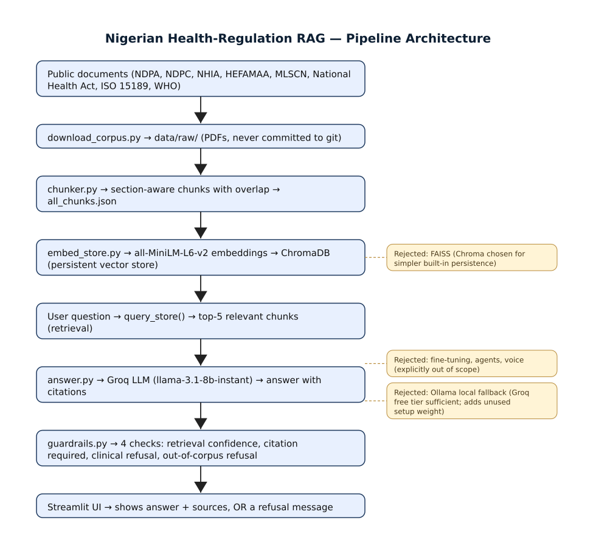

# Architecture Note — B1 Health-Regulation Q&A

## Overview

B1 is a retrieval-augmented question-answering assistant for Nigerian health-sector regulation. It answers plain-English questions about a fixed corpus of eight public documents (the NDPA, NDPC guidance, NHIA Act, HEFAMAA requirements, MLSCN guidelines, National Health Act 2014, and WHO laboratory-quality guidance), cites the document and section behind every claim, and refuses — rather than guesses — on questions outside the corpus or asking for clinical advice. The system is intentionally small: one retriever, one LLM call per question, no agents, no user state.

## Data Flow

Documents are downloaded as PDFs, split into passages, embedded, and persisted to a local vector store. At query time the user's question is embedded against the same model, the five closest passages are retrieved, and those passages plus the question are sent to a hosted LLM with a system prompt requiring in-context answers and [Document, Section] citations. Four lightweight rule-based guardrails inspect the retrieved set and the generated answer before it is shown; failures are replaced with a refusal message listing reasons. Results are presented in a Streamlit UI that shows the answer, sources, latency, and model. A top-to-bottom diagram of this flow — including the rejected alternatives noted below — is in `docs/architecture_diagram.svg`.

## Key Decisions

**Chunking.** A custom section-aware splitter divides each document into ~1,000-character passages with 150 characters of overlap. It first splits on legal-style headers (Parts, Sections, Schedules, Articles), then on paragraph (double-newline) boundaries, falling back to sentence boundaries for any paragraph larger than the chunk limit. Generic fixed-length splitting would have sliced across section boundaries; with legal material that matters because section titles are what get surfaced as citations, and destroying those boundaries makes the citation field unreliable.

**Embedding model.** Passages are embedded locally with all-MiniLM-L6-v2 from sentence-transformers. The model runs on CPU with no external call, so there is zero per-query embedding cost and no rate-limit ceiling. Larger embeddings (e.g. bge-large, Cohere/OpenAI hosted endpoints) would give marginally better recall, but for a corpus of ~1,200 chunks on a single topic domain the smaller model was sufficient and dramatically simpler to operate.

**Vector store.** ChromaDB runs as a persistent local store on disk. FAISS would have been marginally faster at query time, but Chroma ships with built-in persistence, collection management, and add/skip-idempotency semantics without extra glue code. At this corpus size (~1,200 vectors) performance is not a constraint, so the operational simplicity wins.

**LLM.** Groq's hosted llama-3.1-8b-instant is used for generation. The free tier and sub-second generation speed mattered for iteration: the evaluation harness runs 30 questions through the full pipeline end-to-end and needs to be re-run after every change, which would be painful against a slow or paid endpoint. Answer quality is good enough that no larger or more expensive model was needed for the regulatory-question task.

**Guardrails.** Four independent rule-based checks run after generation: (1) retrieval confidence (closest chunk within a distance threshold), (2) at least one well-formed citation, (3) clinical-question block (diagnosis, dosing, prescribing, treatment advice), and (4) minimum number of relevant chunks (out-of-corpus refusal). These are layered on the output of the model rather than folded into the system prompt, because prompt-only instruction proved unreliable in testing — on the intermediate checkpoint a clinical question produced a plausible but unsafe answer that a prompt instruction alone did not prevent, while a post-generation check reliably intercepted it.

## What Was Rejected and Why

- **Fine-tuning** — unnecessary; a 30-question test set does not justify training, and RAG + prompt already handles the task.
- **Agents / tool use / multi-step reasoning** — adds latency and failure modes without benefit for single-hop regulatory lookups.
- **Voice, multi-language, chat history, user accounts, mobile client** — product-scope expansions beyond a single-turn Q&A prototype.
- **Ollama local fallback** — adds setup weight and binary dependencies with no practical benefit while the Groq free tier handles the load.
- **FAISS as the primary store** — see above; manual index persistence was not worth the engineering for this corpus size.
